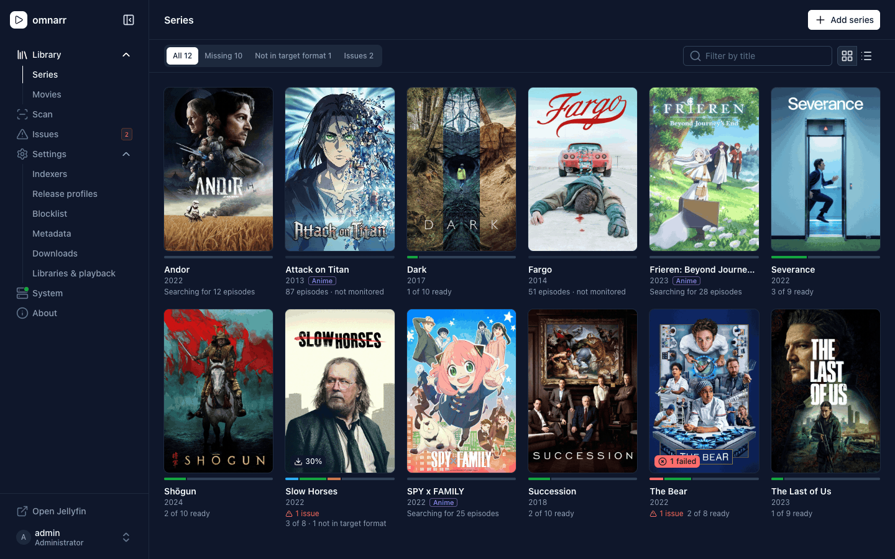
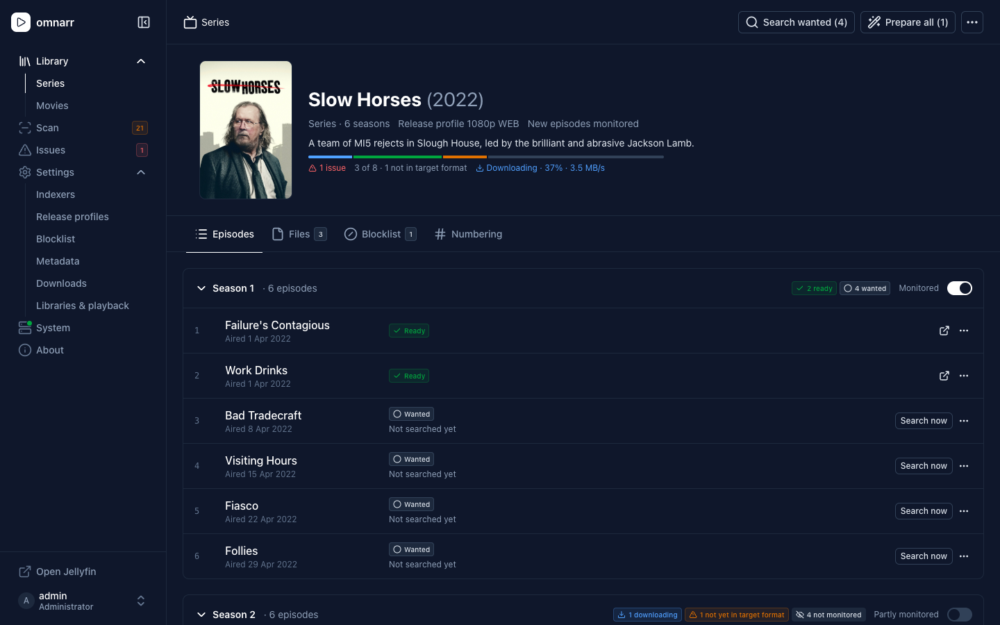
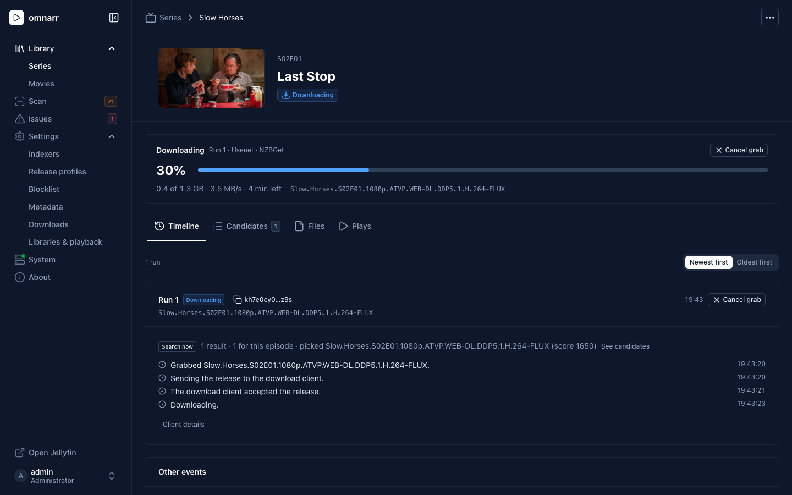
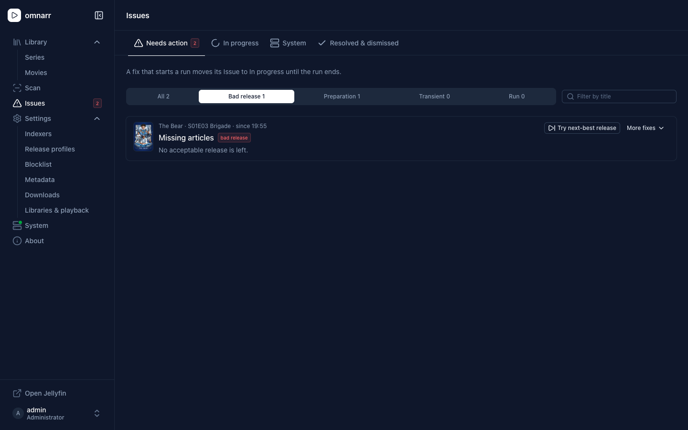
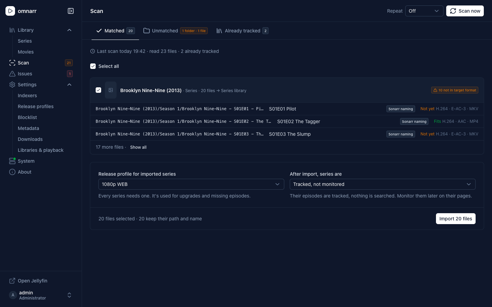
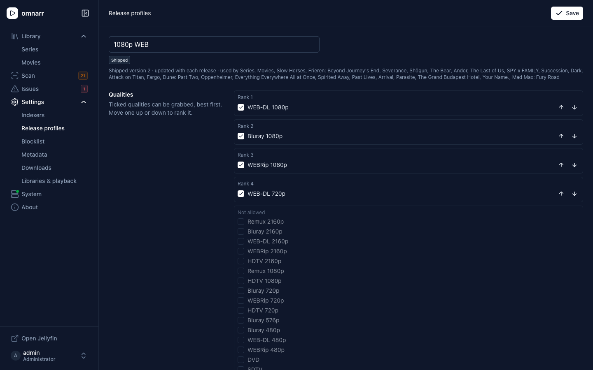
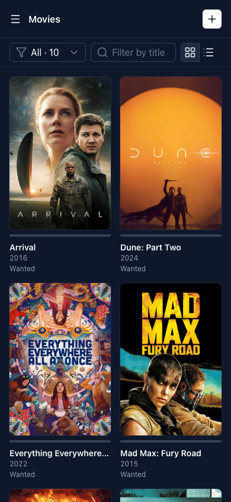

  

<h1 align="center">omnarr</h1>

  
  
  

  One self-hosted app for series, movies and anime: it finds them, downloads them, makes them play on your devices and hands them to Jellyfin.

omnarr replaces Prowlarr, Sonarr and Radarr, and the wiring between them and your download clients. It runs NZBGet, qBittorrent and Jellyfin for you and configures them itself. When a download fails, it tells you why and what to do in one place.

Status: 100.0.0, the first release. Everything below works today.

## Major features

- **One library.** Series, movies and anime in one place. Add a title from TMDB, choose the seasons and episodes to follow, and see each episode's state at a glance.
- **Indexers built in.** Newznab and Torznab indexers, Nyaa, and public sites from Prowlarr's indexer definitions, with health and rate limits on one page. No Prowlarr or Jackett needed.
- **Download clients you never open.** omnarr runs and configures NZBGet for Usenet and qBittorrent for torrents, seeds to your goal, and can route torrents through a VPN (gluetun) that stops traffic when the tunnel drops.
- **Explains every pick.** Release profiles decide what to grab. Every candidate keeps its score and the reasons it was picked or rejected, and you can search yourself and pick by hand.
- **Recovers by itself.** A broken release (missing articles, a stalled torrent, the wrong episode) is blocklisted and the next-best one is grabbed, up to three times before it raises an Issue. A release you picked by hand is blocklisted but not replaced.
- **Quality upgrades.** RSS and a weekly search replace a file when a better release turns up.
- **Files that direct-play.** Tick your devices (Chrome, the Jellyfin Android app, Jellyfin on Fire TV) and omnarr prepares files with ffmpeg so Jellyfin can direct-play them. If preparation fails, the original stays playable.
- **Jellyfin, set up for you.** omnarr sets up Jellyfin, publishes each file and checks that Jellyfin reads it as the right episode or movie.
- **Brings your existing media.** A scan finds the files already in your library folders, matches them to titles and lets you review what it couldn't match.
- **Problems in one place.** The Issues page lists what needs you, most with a fix action. Each episode has a timeline of every search, download and import, and a support bundle collects what a bug report needs.
- **Scene and anime numbering.** TheXEM and Anime-Lists map releases numbered differently from TMDB onto the right episode.
- **Safe upgrades of omnarr itself.** It backs up before it migrates, and tells you when a new release is out.

## Screenshots

  

  

  

  

  

  

  

## Install

You need Docker Engine and Docker Compose 2.24 or later, with all media on one filesystem.

1. Download `compose.yml` and `compose.vpn.yml` from the [latest release](https://github.com/dev-marzahn/omnarr/releases/latest) into an empty folder. They pull the `ghcr.io/dev-marzahn/omnarr-*` images of that release.
2. Run `docker compose up -d`. No `.env` is needed.
3. Run `docker compose logs setup` and copy the setup password it printed.
4. Open `http://<this host>:3000`, create the admin account with it, and follow the first run: indexer, Usenet provider, torrents, your devices and the metadata key.

Existing media goes in `library/series` (series and anime) and `library/movies` in the media folder (`./data` by default). Settings, the VPN, remote access behind your own HTTPS proxy, upgrades, backups and the password reset are in [docs/install.md](docs/install.md). Your install's state lives in Docker volumes, not in the install folder.

## Data sources

This product uses TMDB and the TMDB APIs but is not endorsed, certified, or otherwise approved by TMDB.

- [TMDB](https://www.themoviedb.org): titles, posters, seasons and air dates.
- [TheXEM](https://thexem.info): scene numbering, credited with thanks.
- [Anime-Lists](https://github.com/Anime-Lists/anime-lists): anime numbering and AniDB links, credited with thanks.

Each installation fetches these sources itself; the project publishes none of their data.

## Contributing

How to build, test and change omnarr is in [CONTRIBUTING.md](CONTRIBUTING.md); how it is put together is in [ARCHITECTURE.md](ARCHITECTURE.md).

## Licence

GPL-3.0. See [LICENSE](LICENSE) and the dependency licences in [CONTRIBUTING.md](CONTRIBUTING.md#dependency-licences).
